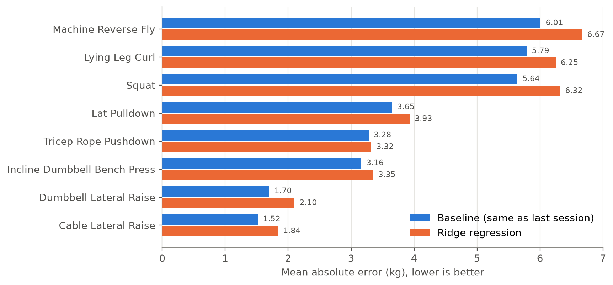

# Predicting Next-Session Strength From Personal Training Logs

A single-athlete case study by Javokhir Abduraxmonov (Tashkent, 2026).

I logged my training for 22 months in the LiftOff app. This project asks
whether that log can predict my strength in the next session of an
exercise, measured as estimated one-repetition maximum (e1RM), more
accurately than the simplest rule: *it will be the same as last time*.

For my data, the answer is no. Across 244 predictions on eight exercises,
no model I tested beat that rule.

**Full report:** [Research_Report.pdf](reports/Research_Report.pdf)
(APA style, 19 pages; [Word version](reports/Research_Report.docx))

## Results

Mean absolute error (MAE) of the 244 next-session predictions. Lower is better.

| Method | MAE (kg) |
|---|---|
| Same as last session (baseline) | **3.76** |
| Last session plus my average past change (no predictors) | 3.97 |
| Ridge regression, six training predictors | 4.14 |
| Random forest, same predictors | 4.25 |
| Mean of the last three sessions | 5.03 |



- Ridge regression was less accurate than the baseline on all eight
  exercises, though on Tricep Rope Pushdown by only 0.03 kg (3.316 vs
  3.283 kg; the figure rounds these to 3.32 and 3.28). Over all 244
  predictions, the difference was significant (paired Wilcoxon
  signed-rank test, *p* < .001).
- No set of predictors did better than using none: every model in the
  feature ablation had a higher error than the no-predictor model (3.97 kg).
- The result held when only sets of 10 or fewer repetitions were counted,
  and when the Brzycki equation replaced the Epley equation.
- Apple Watch sleep data did not help. On the 82 sessions with sleep data,
  adding it raised the error from 4.64 to 4.91 kg (*p* = .64).

Most changes between sessions are small: the score stayed exactly the same
27.5% of the time, and 58% of changes were smaller than 2.5 kg. What
probably drives the rest, such as effort, readiness on the day and which
machine I used, is not in the log.

## Method in brief

- **Data:** my LiftOff export, 2,645 sets from July 26, 2024 to
  May 28, 2026. Two logging errors (14 sets) were removed.
- **Score:** for each session, the e1RM of the best set, using the Epley
  equation: weight × (1 + reps / 30).
- **Exercises:** the eight exercises with at least 30 sessions before
  February 1, 2026 (324 sessions).
- **Evaluation:** walk-forward. Each prediction uses only the sessions
  before it, and every model is refitted at each step, starting after 10
  sessions of history.
- **Models:** ridge regression and a random forest, one per exercise,
  predicting the change from the current session. The six predictors are
  days since the previous session, the current score minus the recent
  average, the spread of recent scores, session volume, the number of
  earlier sessions, and the most reps in one set.

## Run it

Python 3.10 or newer.

```bash
pip install -r requirements.txt
python scripts/run_all.py
```

This rebuilds `data/processed/` and `reports/` from the raw log, which
takes a few minutes. To test the data pipeline, run `python -m pytest tests`.

| Step | Script | What it does |
|---|---|---|
| 1 | `src/clean_raw.py` | removes the 14 mis-logged sets |
| 2 | `scripts/run_pipeline.py` | builds one row per exercise session, with predictors and the next session's score ([details](docs/pipeline.md)) |
| 3 | `src/select_exercises.py` | keeps the eight exercises with 30+ sessions |
| 4 | `src/baseline.py` | the two baselines |
| 5 | `src/ridge_model.py` | ridge regression against the baseline |
| 6 | `src/ablation.py` | feature ablation |
| 7 | `src/random_forest.py` | random forest |
| 8 | `src/robustness.py` | 10-rep and Brzycki checks |
| 9 | `src/sleep.py` | sleep test (skipped without the private sleep data) |
| 10 | `src/data_summary.py` | descriptive numbers quoted in the report |
| 11 | `src/figures.py` | Figures 1–4 |

The committed results were produced on Windows with Python 3.14. On
another system or with other library versions, the full-precision
prediction files can differ in the last decimal places, which can
occasionally move a rounded value by 0.01.

## Repository

```
data/raw/            the LiftOff export (weights in lb, as exported)
data/processed/      cleaned log and modeling tables, rebuilt by the scripts
liftoff_pipeline/    package that turns the export into one row per exercise session
scripts/             run_pipeline.py and run_all.py
src/                 one script per analysis step
reports/             result tables, figures and the report
tests/               tests for liftoff_pipeline
journal.md           research journal: each step, decision and correction
```

## Data

I entered weights in kg, but LiftOff exports them in lb, so the pipeline
converts them back (`--weight-unit lb`). The removed sets are listed in
`data/processed/removed_rows.csv`.

The sleep data (Apple Watch, June 2025 to September 2026) is not included
because it is personal health data; it is available on request.
`src/sleep.py` needs it, and its results are in `reports/sleep_results.csv`.
